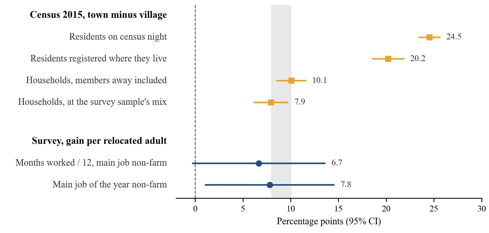

I am a PhD candidate in Economics at the University of California, Davis. My advisor is Giovanni Peri. From January to May 2027 I will be a visiting student researcher at Stanford's Center on China's Economy and Institutions (SCCEI). I am on the 2026-27 job market.

My fields are development and labor economics. My research asks whether poor rural households are poor because of who they are or because of where they live. Governments have three broad options: move people to opportunity, bring opportunity to people, or secure the livelihoods of those who stay. I evaluate a national policy of each type in rural China.

I also publish in machine learning, and I use these methods to build economic measures from text and other unstructured data.

**Email:** anrliu@ucdavis.edu &nbsp;·&nbsp; [CV (PDF)](/files/Liu_Anran_CV.pdf) &nbsp;·&nbsp; [All research](/publications/)

Job Market Paper
======
**[Poor People or Poor Places? Evidence from China's Poverty Alleviation Relocation](/publication/poor-people-or-poor-places)**

Is extreme rural poverty a property of the people or the place? We study this question using China's Poverty Alleviation Relocation program, which moved 9.61 million residents out of remote villages between 2016 and 2020. Exploiting the staggered timing of destination housing construction, we estimate the impact of moving these communities closer to labor markets. Relocation increases adult employment by 20 percent and annual earnings by 38 percent. These gains occur among both new entrants to wage labor and existing workers. Per relocated adult, the rise in non-farm work comes to most of the gap between comparable town and village households. Heterogeneity analysis shows that earnings gains are largest for households experiencing the greatest reduction in travel time to the county seat. Combined with the value of new housing, the long-run income gains exceed the program's costs. We conclude that geographic isolation is a binding constraint on the earning potential of the remote poor. By relaxing this spatial constraint, relocation suggests that for these households the gap with the towns is largely a property of the place.

<figure>
  
  <figcaption>Per relocated adult, the rise in non-farm work (blue, survey) comes to most of the gap between comparable town and village households in the same county (gray band, 2015 population census). Bars are 95 percent confidence intervals.</figcaption>
</figure>

Presented at the Econometric Society NASM and AMES 2026; CES 2026; CUFE International Doctoral Forum; UC Davis ARE Development Seminar; ANU Asian Perspective Seminar (scheduled).

中文简介
======
我是加州大学戴维斯分校经济学博士候选人，导师是 Giovanni Peri，2026-27 年度求职。2027 年 1 月至 5 月在斯坦福大学中国经济与制度研究中心（SCCEI）访问。研究领域是发展经济学和劳动经济学。我的研究问的是：农村贫困家庭穷，是因为人本身，还是因为所处的地方？政府可以把人搬到有机会的地方，把机会带到人身边，或者保障留下来的人的生计。三类政策中，我各评估了一项中国农村的全国性政策。我也在机器学习方向发表论文，并用这些方法从文本等非结构化数据中构造经济度量。
