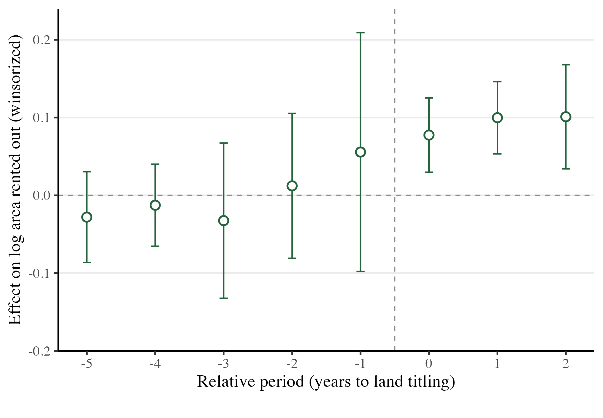

Rural workers in China face no statutory retirement age and thin pension coverage, and most of their wealth is in land that cannot be sold. We show that land titling lets older adults turn this land into income without farming it. Using the national rollout and CHARLS panel data, we find that titling lowers labor-force participation by 3.2 percentage points and increases the land households rent out. Adults past 60 leave the labor force, while those aged 45 to 59 stay employed and move out of farming. A reform that transfers no money can work like a pension.

<figure>
  
  <figcaption>Effect of titling on log(1 + area of land rented out), by year relative to titling, from the imputation event-study estimator. The area rises in the titling year and stays higher two years on. Bars are 95 percent confidence intervals clustered by village.</figcaption>
</figure>
