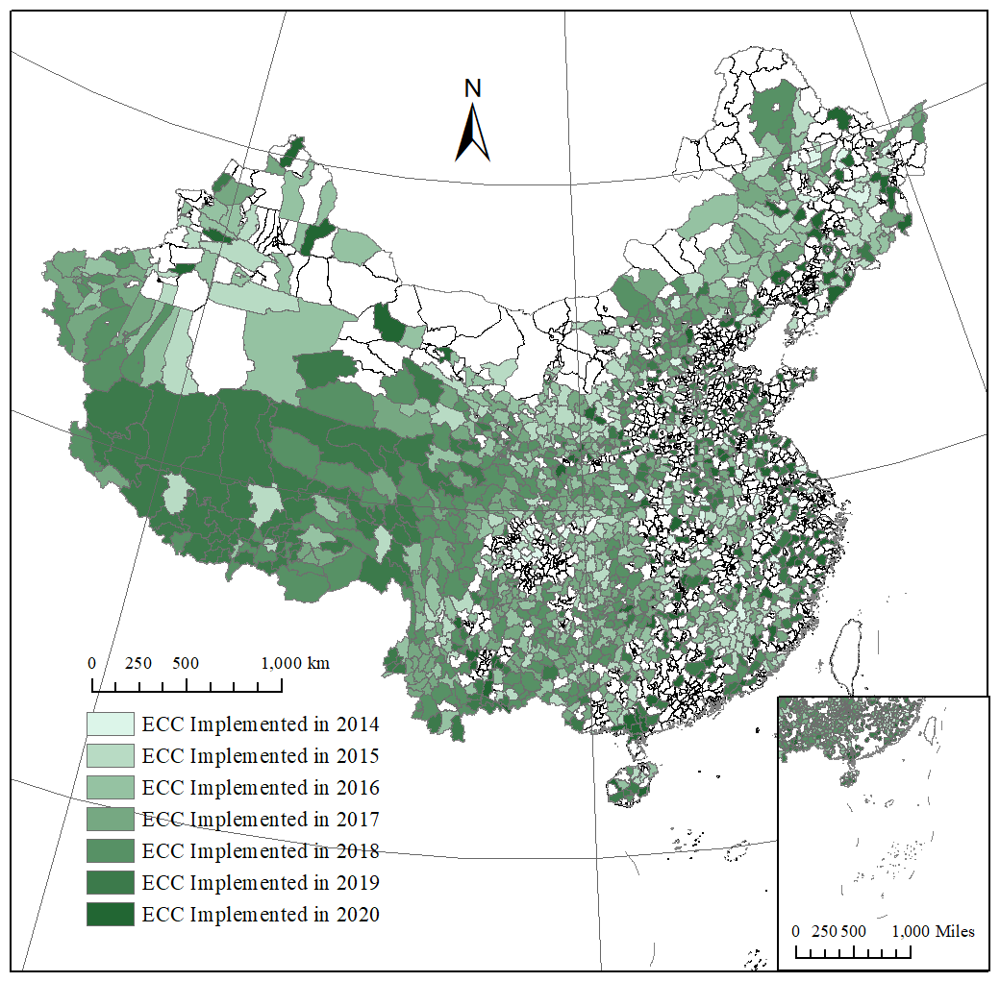

Moving people is expensive and reaches only some villages. The alternative is to bring markets to them. We study a national program that paired online platforms with logistics, training, and promotion in rural counties. Across its staggered county rollout, net household income rises 12.4 percent and households shift toward farming for the market. Lower-income households gain more, so the program narrows both the rural-urban gap and inequality within rural areas. Benefits exceed fiscal costs by more than a factor of five.

<figure>
  
  <figcaption>Counties in the E-commerce into the Countryside program, shaded by the year they joined, 2014 to 2020. The paper compares households in counties that joined earlier with those in counties that had not yet joined.</figcaption>
</figure>
