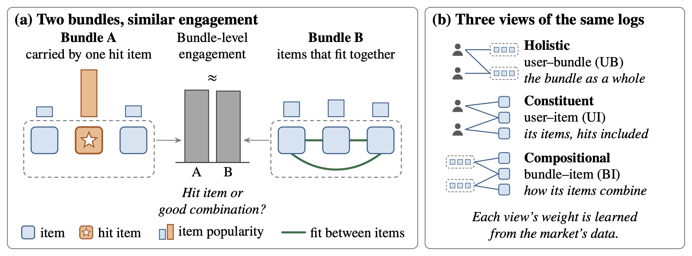

When does composition-aware bundle recommendation, which models items and their fit separately, pay off, and can a platform tell in advance from its logs? Engagement with a bundle can reflect hit items or how well its items fit together. A multi-attribute utility decomposition yields a boundary condition: separating constituent from compositional preference pays off only where bundle choices are coupled to item-level signals, and preset channel weights lose accuracy in proportion to their squared gap from the market's coupling.

<figure>
  
  <figcaption>Two bundles can draw similar engagement, one because of a hit item and one because its items fit together. The model reads the same logs through three views and learns each view's weight from the market's data.</figcaption>
</figure>
